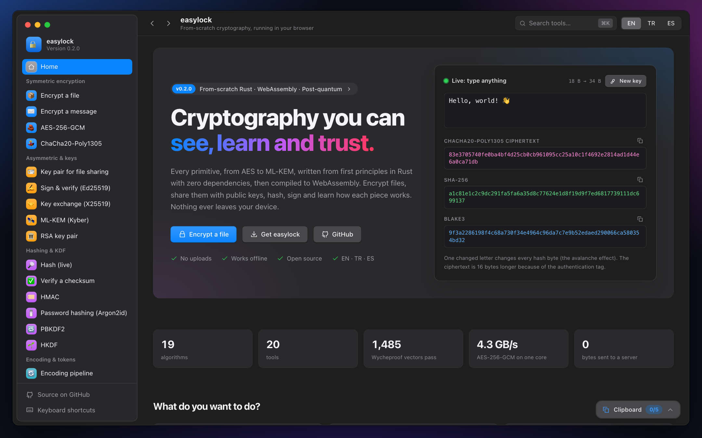
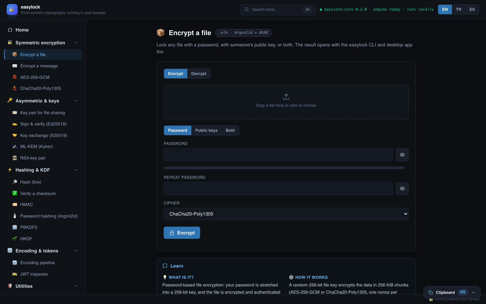
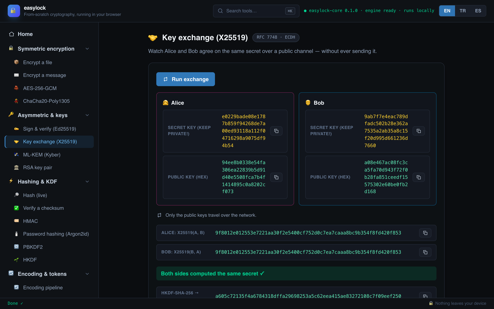
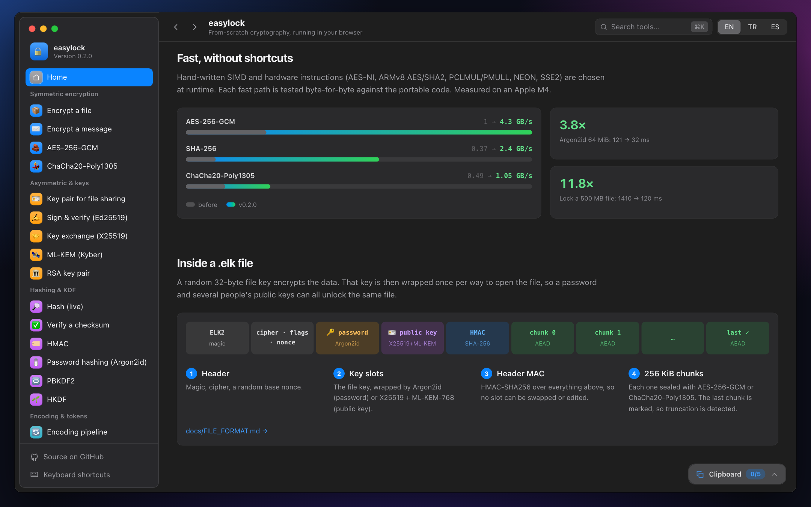
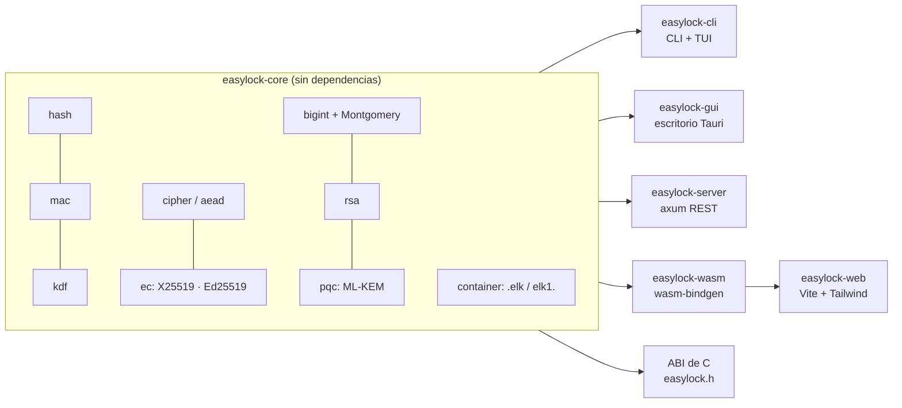

<div align="center">

<a href="https://zlixas.github.io/easylock/"></a>

<p>
  <a href="https://github.com/zlixas/easylock/releases/latest"></a>
  <a href="https://github.com/zlixas/easylock/actions/workflows/ci.yml"></a>
  <a href="https://zlixas.github.io/easylock/"></a>
  <a href="#licencia"></a>
  <a href="rust-toolchain.toml"></a>
  
  
</p>

<h3>
  <a href="https://zlixas.github.io/easylock/">🌐 Abrir la aplicación web</a>
  &nbsp;·&nbsp;
  <a href="#instalar">⬇️ Instalar</a>
  &nbsp;·&nbsp;
  <a href="docs/FILE_FORMAT.md">📄 Formato de archivo</a>
  &nbsp;·&nbsp;
  <a href="docs/ARCHITECTURE.md">🧭 Arquitectura</a>
</h3>

[English](README.md) · [Türkçe](README.tr.md) · Español

</div>

<br>

**easylock** es un conjunto de herramientas criptográficas escrito **desde cero en Rust**: cada primitiva, desde AES hasta
ML-KEM poscuántico, está implementada a partir de principios básicos y **sin dependencias**. El mismo motor impulsa una
**línea de comandos**, una **interfaz de terminal**, una **aplicación de escritorio** y un **sitio web que se ejecuta por
completo en su navegador**, y las cuatro comparten un mismo formato de archivo cifrado.

<table>
<tr>
<td width="33%" valign="top">

### 📦 Cifre cualquier cosa
Archivos y carpetas enteras, con una contraseña, con las **claves públicas** de otras personas o con ambas. Procesa en flujo a varios GB/s con memoria constante.

</td>
<td width="33%" valign="top">

### 🛰️ Compartir poscuántico
Los destinatarios usan una clave híbrida **X25519 + ML-KEM-768**, de modo que los archivos grabados siguen a salvo incluso frente a un futuro ordenador cuántico.

</td>
<td width="33%" valign="top">

### 🔐 Almacenes cifrados
Una carpeta donde los archivos **permanecen cifrados**. También se ocultan los nombres y los tamaños, y se sincroniza de forma segura con iCloud, Dropbox o Git.

</td>
</tr>
<tr>
<td valign="top">

### 🎓 Aprenda practicando
20 herramientas interactivas, cada una con un panel **Aprender** (*qué · cómo · cuándo · precauciones*), en inglés, turco y español.

</td>
<td valign="top">

### ⚡ Realmente rápido
Rutas AES-NI / ARMv8, PCLMUL / PMULL, SHA-NI, NEON y SSE2 escritas a mano: **4,3 GB/s** en AES-GCM y **2,4 GB/s** en SHA-256.

</td>
<td valign="top">

### 🧪 Hecho para verificarse
Vectores oficiales de NIST/RFC, **1485 casos límite de Wycheproof**, fuzzing, pruebas diferenciales y versiones firmadas y con procedencia certificada.

</td>
</tr>
</table>

<div align="center">
<a href="https://zlixas.github.io/easylock/"><picture><source media="(prefers-color-scheme: light)" srcset="docs/images/web-home-light.png"></picture></a>
<sub>Una aplicación al estilo macOS en su navegador, en modo claro y oscuro. La página de inicio cifra y calcula el hash de lo que escribe, en vivo, con el motor de Rust compilado a WebAssembly.</sub>
</div>

> [!WARNING]
> **Educativo y sin auditar.** Cada primitiva está implementada a partir de principios básicos y
> comprobada con vectores de prueba oficiales (NIST CAVP, FIPS 197/180-4/202/203, RFC 7748/8032/8439/9106 …) y con Project Wycheproof.
> Eso es necesario, pero **no basta** para que el código sea seguro en producción. Nadie lo ha
> auditado de forma independiente. Para proteger secretos reales, use una herramienta revisada como
> `age`, `ring`, RustCrypto, libsodium o aws-lc. Consulte [SECURITY.md](SECURITY.md).

---

## Contenido

- [¿Por qué easylock?](#por-qué-easylock)
- [Instalar](#instalar)
- [Inicio rápido](#inicio-rápido)
- [Qué incluye](#qué-incluye)
- [Las cuatro interfaces](#las-cuatro-interfaces)
- [Rendimiento](#rendimiento) · [Calidad y garantías](#calidad-y-garantías)
- [Arquitectura](#arquitectura) · [Compilar y probar](#compilar-y-probar)
- [Preguntas frecuentes](#preguntas-frecuentes) · [Hoja de ruta](#hoja-de-ruta)
- [Contribuir](#contribuir) · [Citar](#citar) · [Licencia](#licencia)

## ¿Por qué easylock?

La mayoría de la gente usa la criptografía como una caja negra. easylock abre la caja:

- **Desde cero.** `easylock-core` no tiene *ninguna* dependencia en tiempo de ejecución. Implementa SHA-2, SHA-3, BLAKE3, AES y
  su GHASH, ChaCha20-Poly1305, Argon2id, Curve25519, RSA con un motor de enteros grandes de tiempo constante y el
  ML-KEM poscuántico, todo en Rust legible.
- **Verificado.** Más de 170 pruebas comparan el código con vectores publicados, y compila sin ninguna advertencia con `clippy::pedantic`.
- **Explicado.** Cada herramienta del sitio web tiene un panel **Aprender** con cuatro partes: *qué es*, *cómo funciona*,
  *cuándo usarla* y *qué precauciones tomar*. Todo está disponible en inglés, turco y español.
- **Interoperable.** La CLI, la interfaz de terminal, la aplicación de escritorio y el sitio web comparten un mismo formato de archivo `.elk`.
  Un archivo que cifra en la terminal se abre en el sitio web, y uno que cifra en el sitio web se abre en la terminal.
- **Privado.** El sitio web compila el mismo núcleo de Rust a WebAssembly, así que nunca envía ni un byte a un servidor.

## Instalar

| Plataforma | Línea de comandos + interfaz de terminal | Aplicación de escritorio |
|---|---|---|
| **macOS** | `brew install zlixas/tap/easylock` | [Apple Silicon `.dmg`](https://github.com/zlixas/easylock/releases/latest/download/easylock-desktop-macos-arm64.dmg) · [Intel `.dmg`](https://github.com/zlixas/easylock/releases/latest/download/easylock-desktop-macos-x64.dmg) |
| **Linux** | `curl -fsSL https://raw.githubusercontent.com/zlixas/easylock/main/install.sh \| sh` | [`.AppImage`](https://github.com/zlixas/easylock/releases/latest/download/easylock-desktop-linux-x64.AppImage) · [`.deb`](https://github.com/zlixas/easylock/releases/latest/download/easylock-desktop-linux-x64.deb) |
| **Windows** | `irm https://raw.githubusercontent.com/zlixas/easylock/main/install.ps1 \| iex` | [Instalador `.exe`](https://github.com/zlixas/easylock/releases/latest/download/easylock-desktop-windows-x64.exe) · [`.msi`](https://github.com/zlixas/easylock/releases/latest/download/easylock-desktop-windows-x64.msi) |
| **Navegador** | no hace falta instalar nada: **<https://zlixas.github.io/easylock/>** (funciona sin conexión como PWA) | |
| **Código fuente** | `cargo install --git https://github.com/zlixas/easylock easylock-cli` | `cd crates/easylock-gui && cargo tauri build` |

Los scripts de instalación comprueban la descarga con el `SHA256SUMS` de la versión, y la fórmula de Homebrew fija sus hashes.
Cada archivo publicado figura en el `SHA256SUMS` firmado con Ed25519 y tiene procedencia de compilación (build provenance) de GitHub:

```sh
easylock verify --public "$(cat RELEASE_SIGNING_KEY.txt)" -S "$(cat SHA256SUMS.sig)" SHA256SUMS
gh attestation verify easylock-aarch64-apple-darwin.tar.gz --repo zlixas/easylock
```

> [!NOTE]
> Las aplicaciones de escritorio todavía no están firmadas por Apple ni por Microsoft. En macOS, la primera vez haga clic derecho → **Abrir**;
> en Windows, elija **Más información → Ejecutar de todas formas**.

## Inicio rápido

```sh
easylock tui                               # interfaz interactiva a pantalla completa
easylock lock impuestos.pdf                # → impuestos.pdf.elk  (pide una contraseña)
easylock unlock impuestos.pdf.elk          # → impuestos.pdf
easylock lock ~/Photos --shred             # carpeta entera → Photos.elk, originales borrados

easylock identity                          # su par de claves (X25519 + ML-KEM-768)
easylock lock informe.pdf -r elkpub1…      # cifre para otra persona, sin contraseña compartida
easylock unlock informe.pdf.elk            # se abre con su identidad
echo -n abc | easylock hash -a blake3
easylock password -n 3 -l 24 --symbols
easylock --lang es --help                  # English · Türkçe · Español
```

## Qué incluye

| Familia | Algoritmos | Especificación |
|---|---|---|
| Hash | SHA-256, SHA-512, SHA3-256/512, SHAKE128/256, Keccak-256, BLAKE2b, BLAKE3 | FIPS 180-4, FIPS 202, RFC 7693 |
| MAC | HMAC (con cualquier hash), Poly1305 | RFC 2104, RFC 8439 |
| KDF / contraseñas | Argon2id/i/d (cadenas PHC), PBKDF2, HKDF | RFC 9106, RFC 8018, RFC 5869 |
| AEAD | AES-256-GCM (AES-NI / ARMv8 y PCLMUL / PMULL), ChaCha20-Poly1305 | SP 800-38D, RFC 8439 |
| Cifrados | AES-256, AES-256-CTR, ChaCha20 | FIPS 197 |
| Curvas elípticas | X25519, Ed25519 | RFC 7748, RFC 8032 |
| RSA | generación de claves, PKCS#1 v1.5, OAEP, CRT | RFC 8017 |
| Poscuántico | ML-KEM-512 / 768 / 1024 (Kyber) | FIPS 203 |
| Codificaciones | Hex, Base64, Base64URL, Base58, ROT13, cadenas de transformaciones encadenables | RFC 4648 |
| Contenedores | archivos `.elk` y tokens de texto `elk1.` (Argon2id + AEAD por bloques) | [docs/FILE_FORMAT.md](docs/FILE_FORMAT.md) |

Entre las piezas de apoyo se incluyen el borrado de memoria con `write_volatile`, `Zeroizing<T>` / `Secret<N>`, comparación y
selección en tiempo constante, despacho según las capacidades de la CPU en tiempo de ejecución, una ABI de C ([`easylock.h`](crates/easylock-core/include/easylock.h)) y
benchmarks con `criterion`.

## Las cuatro interfaces

### 🌐 Sitio web (WebAssembly)

<table>
<tr>
<td width="50%"></td>
<td width="50%"></td>
</tr>
<tr>
<td align="center"><sub>Cifre un archivo con una contraseña, con claves públicas o con ambas</sub></td>
<td align="center"><sub>Intercambio de claves X25519, paso a paso</sub></td>
</tr>
</table>

El sitio web tiene 20 herramientas en cinco categorías. Cada una incluye un panel *Aprender* y se ejecuta por completo en su dispositivo.

| | Herramientas |
|---|---|
| 🔒 Simétrico | Cifrar un archivo (`.elk`, contraseña y/o claves públicas) · Cifrar un mensaje (token `elk1.`) · AES-256-GCM · ChaCha20-Poly1305 |
| 🔑 Asimétrico | Par de claves para compartir archivos · Firmar y verificar con Ed25519 · Recorrido del intercambio de claves X25519 (Alice ⇄ Bob) · ML-KEM · RSA-2048 |
| ⚡ Hash y KDF | Hash múltiple en vivo · Verificador de sumas de comprobación (detecta el algoritmo) · HMAC · Hash y verificación con Argon2id · PBKDF2 · HKDF |
| 🔄 Codificación | Cadena de codificación · Inspector de JWT (comprueba firmas HS256/HS512/EdDSA) |
| 🛡️ Utilidades | Generador de contraseñas · Estimador de fortaleza de contraseñas · Bytes / tokens / UUID / PIN / frases de contraseña aleatorios |

El sitio también tiene una paleta de comandos (<kbd>⌘/Ctrl</kbd>+<kbd>K</kbd> o <kbd>/</kbd>), atajos de teclado (<kbd>?</kbd>), un diseño
que funciona en teléfonos, un selector EN/TR/ES (<kbd>Alt</kbd>+<kbd>L</kbd>) y un portapapeles flotante que guarda hasta cinco resultados recientes.
El portapapeles se borra al cerrar la pestaña o tras 5 minutos de inactividad.
El sitio es una **PWA** instalable que funciona **sin conexión**. Se ejecuta con una Content-Security-Policy estricta, sin peticiones a terceros,
y las operaciones lentas (Argon2, cifrado de archivos) se ejecutan en un Web Worker para que la página siga respondiendo.

### 🗄️ Cifrado de archivos en detalle

`easylock lock` está pensado para el uso real:

- **En flujo y multinúcleo.** El uso de memoria es constante (≈120 MB, sobre todo para Argon2) sea cual sea el tamaño del archivo. Los bloques se cifran en todos
  los núcleos en una cadena de procesamiento. Un archivo de 500 MB tarda unos 0,3 s antes del `fsync` final.
- **Carpetas.** Árboles de carpetas completos caben en un único archivo `.elk`. La extracción está protegida contra el recorrido de rutas (path traversal).
- **Claves públicas.** `-r` cifra para una o varias personas con un híbrido X25519 + ML-KEM-768, de modo que los archivos son seguros
  frente a ataques poscuánticos. Puede combinar `-r` con `--with-password`.
- **Seguro por defecto.** La salida va a un archivo temporal y solo se renombra cuando todo ha salido bien y se ha hecho `fsync`.
  Los archivos existentes nunca se sobrescriben sin `--force`. Una clave incorrecta no deja nada atrás.
- **`--shred`.** Tras un cifrado correcto, los originales se sobrescriben y se eliminan.
- **Tuberías.** Ejemplo: `tar c dir | easylock lock - -r KEY > backup.elk`.
- **Compatible.** Los mismos archivos se abren en el sitio web y en la aplicación de escritorio, y los archivos ELK1 antiguos se siguen descifrando.

El formato a nivel de bytes está documentado en [docs/FILE_FORMAT.md](docs/FILE_FORMAT.md).

### 🔐 Almacén cifrado

Un almacén es una carpeta donde los archivos **permanecen cifrados**. Los nombres, tamaños y fechas de los archivos se ocultan en un índice cifrado,
y nunca se escribe texto en claro dentro del almacén.

```sh
easylock vault init ~/Private.vault                 # contraseña y/o claves públicas con -r
easylock vault add  ~/Private.vault taxes/ id.pdf --shred
easylock vault ls   ~/Private.vault
easylock vault cat  ~/Private.vault taxes/2025.pdf | open -f
easylock vault get  ~/Private.vault taxes -o ~/Desktop
easylock vault rm   ~/Private.vault id.pdf
easylock vault passwd ~/Private.vault -r elkpub1…   # cambia la clave sin volver a cifrar ningún archivo
```

Los almacenes se sincronizan de forma segura con Dropbox, iCloud o Git porque cada archivo es un objeto independiente con un nombre aleatorio.

### ⌨️ Interfaz de terminal

```sh
easylock tui
```

La interfaz de terminal es una aplicación ratatui manejada con el teclado que tiene nueve herramientas: hash en vivo, codificar/decodificar, generación de contraseñas,
pares de claves, cifrado de texto con contraseña, HMAC, firma/verificación Ed25519, una demostración de intercambio X25519 y una pantalla de información. Teclas:
<kbd>↑↓</kbd>/<kbd>1–9</kbd> eligen una herramienta, <kbd>Tab</kbd> pasa de un campo a otro, <kbd>F5</kbd> copia,
<kbd>F2</kbd> cambia el idioma (EN → TR → ES) y <kbd>F1</kbd> abre la ayuda.

### 💻 Línea de comandos

| Comando | Propósito |
|---|---|
| `hash` | SHA-2/3, Keccak, BLAKE3 sobre stdin o archivos |
| `encode` / `decode` | cadenas encadenables de Hex/Base64/Base58/ROT13 |
| `encrypt` / `decrypt` | AEAD / CTR / XOR con clave en bruto |
| `lock` / `unlock` | cifra archivos **y carpetas** con una contraseña y/o claves públicas (`.elk`) |
| `inspect` | muestra cómo se puede abrir un archivo `.elk`, sin necesidad de contraseña |
| `identity` | crea o muestra su identidad de clave pública |
| `vault` | `init` · `add` · `ls` · `get` · `cat` · `rm` · `passwd` · `info` para un almacén cifrado |
| `hmac` | MAC con clave |
| `kdf` | Argon2id / PBKDF2, con `--verify <PHC>` para comprobar un hash guardado |
| `password` | contraseñas aleatorias sin sesgo, con su entropía |
| `keygen` | Ed25519, X25519, ML-KEM-512/768/1024, RSA-2048 (`--json`) |
| `sign` / `verify` | firmas Ed25519 |
| `info` | versión, backends de hardware activos, catálogo de algoritmos |
| `tui` | la interfaz de terminal |

La CLI traduce todo: los textos de ayuda, los encabezados de clap, los errores y los mensajes de estado. Elige el idioma a partir de
`--lang en|tr|es`, luego de `LC_ALL`/`LANG`, y si no, usa el inglés.

```console
$ easylock --lang tr kdf -p hunter2
$argon2id$v=19$m=65536,t=3,p=4$…
$ easylock --lang es unlock secreto.elk -p mala
easylock: autenticación fallida: clave/nonce incorrectos o los datos fueron modificados
```

### 🖥️ Aplicación de escritorio (Tauri v2)

```sh
cd crates/easylock-gui && cargo tauri build
```

La aplicación de escritorio tiene cuatro pestañas: **Archivos** (cifrado `.elk` arrastrando y soltando, con progreso en flujo), **Hash**, **Convertir** y
**Claves**. Llama a `easylock-core` directamente por IPC de Tauri, sin pasar por HTTP, y está disponible en EN, TR y ES.

También existe **`easylock-server`**, una API REST con `axum` (`/v1/hash`, `/v1/aead/*`, `/v1/kdf/*`, `/v1/keygen`, …) que
además puede servir el panel web.

## Rendimiento

Son cifras de un solo proceso en un Apple M4, medidas con `cargo bench -p easylock-core` y `time`. Todo sigue siendo código escrito desde cero y
sin dependencias. Las rutas de hardware usan las instrucciones propias de cada CPU, se eligen en tiempo de ejecución y recurren a software de tiempo constante cuando no están disponibles.

| Operación | Antes | Ahora | Técnica |
|---|---:|---:|---|
| AES-256-GCM (256 KiB) | 1,0 GB/s | **4,3 GB/s** | AES-NI / ARMv8 AES con 8 bloques intercalados, GHASH agregado con PCLMUL/PMULL (H¹…H⁸) |
| ChaCha20-Poly1305 (256 KiB) | 0,49 GB/s | **1,05 GB/s** | ChaCha20 NEON / SSE2 de 4 bloques, Poly1305 con limbs de 64 bits |
| SHA-256 (256 KiB) | 0,37 GB/s | **2,4 GB/s** | instrucciones ARMv8 SHA2 / Intel SHA-NI |
| Argon2id 64 MiB, t=3, p=4 | 121 ms | **32 ms** | carriles rellenados en varios núcleos, sin copias de bloques |
| `lock` archivo de 500 MB → /dev/null | 1,41 s, 1 GB de RAM | **0,10–0,15 s, ~120 MB** | en flujo, cadena de procesamiento multinúcleo |
| `unlock` archivo de 500 MB → /dev/null | 1,31 s | **0,18 s** | lectura anticipada en cadena, borrado de memoria en bloque |

Cada ruta rápida se compara con la implementación portable en una prueba diferencial: en ARM de forma nativa y en x86-64 con Rosetta y en CI.



## Calidad y garantías

| Comprobación | Dónde |
|---|---|
| Vectores de prueba oficiales (NIST CAVP, RFC, FIPS) | `cargo test` |
| **Project Wycheproof**: 1485 vectores de casos límite | `crates/easylock-core/tests/wycheproof.rs` |
| Pruebas diferenciales: cada ruta SIMD/de hardware frente al código portable | pruebas unitarias, en compilaciones ARM, x86-64 y portables |
| **Fuzzing** (cargo-fuzz): cabeceras, flujos de bloques, archivos comprimidos, decodificadores, AEAD | `fuzz/`, 60 s por objetivo en CI |
| Auditoría de dependencias: licencias, avisos de RustSec, orígenes | `cargo deny check` en CI |
| Cobertura | resumen de `cargo llvm-cov` en cada ejecución de CI |
| Acciones de CI fijadas y Dependabot | `.github/` |

¿Ha encontrado un problema? Consulte [SECURITY.md](SECURITY.md).

## Arquitectura



Para un recorrido guiado por el código fuente, consulte **[docs/ARCHITECTURE.md](docs/ARCHITECTURE.md)**. Explica las técnicas de tiempo
constante, el despacho según la CPU, cómo funciona el motor de enteros grandes y por dónde empezar a leer.

| Crate | Función |
|---|---|
| [`easylock-core`](crates/easylock-core) | Todas las primitivas, `BigUint<N>` de tiempo constante, contenedores, FFI |
| [`easylock-cli`](crates/easylock-cli) | Binario `easylock`: CLI + interfaz de terminal con ratatui, EN/TR/ES |
| [`easylock-gui`](crates/easylock-gui) | Aplicación de escritorio Tauri v2 |
| [`easylock-server`](crates/easylock-server) | API REST + alojamiento estático |
| [`easylock-wasm`](crates/easylock-wasm) | Enlaces para WebAssembly |
| [`easylock-web`](crates/easylock-web) | Interfaz para el navegador (JS puro, sin framework) |

## Compilar y probar

```sh
cargo test   --workspace                  # más de 170 pruebas basadas en vectores
cargo clippy --workspace --all-targets    # sin advertencias con clippy::pedantic
cargo bench  -p easylock-core             # benchmarks con criterion

# el sitio web
cd crates/easylock-web
npm install
npm run wasm     # compilación de easylock-wasm con wasm-pack
npm run dev      # http://localhost:5173
```

Las versiones publicadas cubren Linux `x86_64`/`aarch64`, macOS en Apple Silicon e Intel, y Windows `x86_64`. La CI ejecuta fmt, clippy (pedantic) y el conjunto de pruebas en Ubuntu, macOS y Windows, además de trabajos de WebAssembly, cargo-deny, fuzzing y cobertura.

## Documentación

| Documento | |
|---|---|
| [docs/ARCHITECTURE.md](docs/ARCHITECTURE.md) | Diseño, mapa de módulos, técnicas de tiempo constante |
| [docs/FILE_FORMAT.md](docs/FILE_FORMAT.md) | Especificación a nivel de bytes de los archivos `.elk` y los tokens `elk1.` |
| [SECURITY.md](SECURITY.md) | Modelo de amenazas, limitaciones conocidas, cómo informar de problemas |
| [CONTRIBUTING.md](CONTRIBUTING.md) | Entorno de desarrollo, normas de código, cómo añadir una primitiva o un idioma |
| [CHANGELOG.md](CHANGELOG.md) | Historial de versiones |

## Preguntas frecuentes

<details>
<summary><b>¿Se suben mis archivos a algún sitio cuando uso el sitio web?</b></summary>

No. El motor de Rust se ejecuta dentro de su navegador como WebAssembly. La Content-Security-Policy solo permite los archivos del propio sitio,
no se carga código de terceros y, una vez visitado, el sitio funciona en modo avión.
</details>

<details>
<summary><b>¿Se puede abrir en la terminal un archivo cifrado en el sitio web (y al revés)?</b></summary>

Sí. El sitio web, la CLI, la interfaz de terminal y la aplicación de escritorio leen y escriben el mismo formato `.elk`, byte a byte.
</details>

<details>
<summary><b>¿Qué significa «poscuántico» en los archivos con clave pública?</b></summary>

Cada ranura de destinatario combina X25519 con ML-KEM-768 (FIPS 203) y deriva la clave de envoltura de ambos secretos compartidos.
Un atacante tendría que romper los dos, así que un futuro ordenador cuántico que rompa solo X25519 no abre el archivo.
</details>

<details>
<summary><b>¿En qué se diferencia de age o GPG?</b></summary>

`age` y GPG son herramientas maduras y revisadas, y debería preferirlas para secretos reales. easylock existe para **leerse y
aprender de él**: cada primitiva subyacente está en este repositorio, legible, probada y explicada, y además todo
funciona en un navegador.
</details>

<details>
<summary><b>¿Qué pasa si olvido mi contraseña?</b></summary>

El archivo no se puede recuperar; esa es la idea. Para los archivos importantes, añada su clave pública como segunda forma de abrirlos:
`easylock lock file -r "$(easylock identity --show)" --with-password`.
</details>

## Hoja de ruta

- [x] `.elk` v2 en flujo y multinúcleo, con contraseña y destinatarios poscuánticos híbridos
- [x] Almacenes cifrados · versiones firmadas y con procedencia certificada para Linux, macOS y Windows · Homebrew
- [x] PWA sin conexión con CSP estricta y criptografía en un Web Worker
- [x] Curve25519 más rápido (aritmética de campo en base 2^51, tabla precalculada del punto base: X25519 y Ed25519 ~40 veces más rápidos)
- [ ] Explorador de almacenes en la interfaz de terminal y en la aplicación de escritorio
- [ ] BLAKE3 con SIMD
- [ ] Versiones de escritorio con firma de código
- [ ] Una revisión de seguridad independiente

Las ideas y los pull requests son bienvenidos; consulte [Contribuir](#contribuir).

## Contribuir

Las contribuciones son bienvenidas: nuevas primitivas, más vectores de prueba, traducciones, documentación e informes de errores.
Lea [CONTRIBUTING.md](CONTRIBUTING.md) y el [Código de conducta](CODE_OF_CONDUCT.md).

## Citar

Si easylock le ayuda en su docencia o investigación, puede citarlo mediante [CITATION.cff](CITATION.cff). El botón
«Cite this repository» de GitHub usa ese archivo.

## Licencia

easylock tiene licencia doble, a su elección, bajo cualquiera de estas:

- Apache License, Version 2.0 ([LICENSE-APACHE](LICENSE-APACHE))
- Licencia MIT ([LICENSE-MIT](LICENSE-MIT))

<div align="center">
<br>
<sub>Hecho con 🦀 y muchos vectores de prueba · <a href="https://zlixas.github.io/easylock/">zlixas.github.io/easylock</a></sub>
</div>
