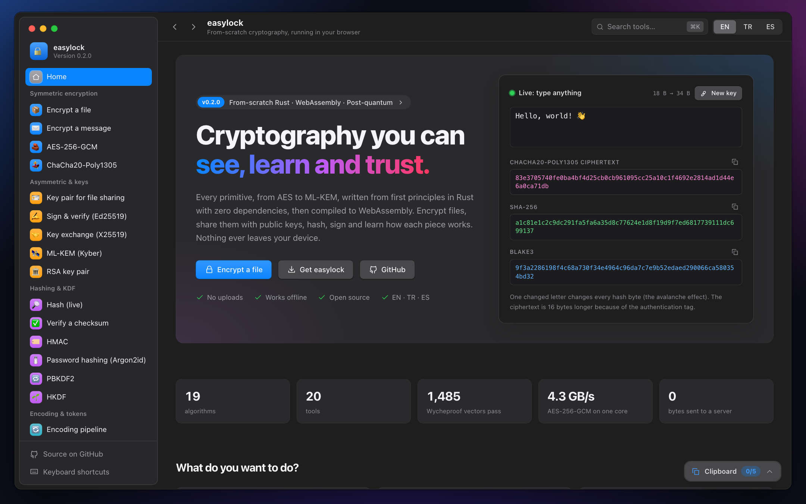
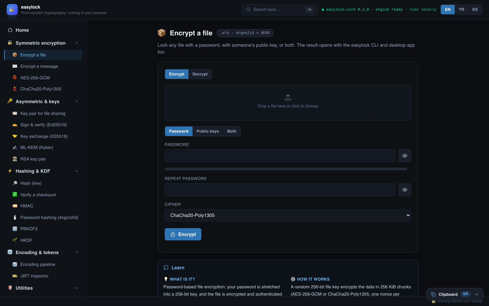
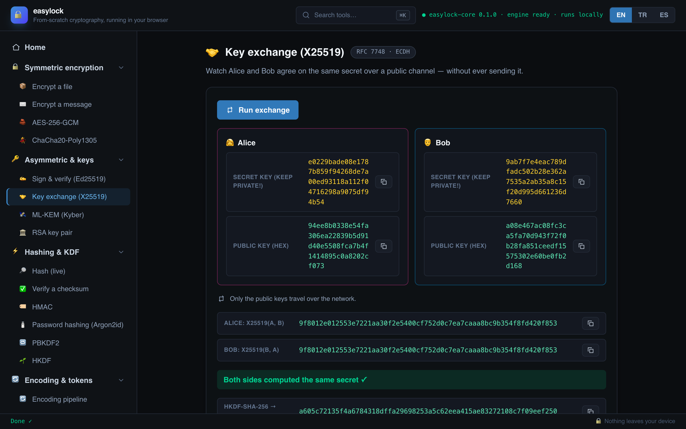
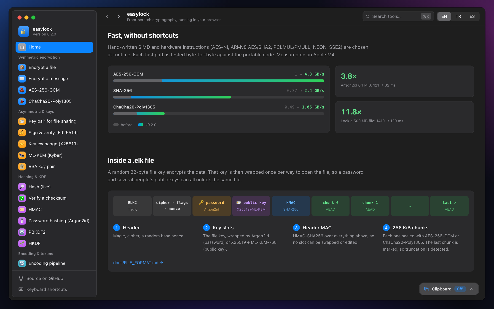
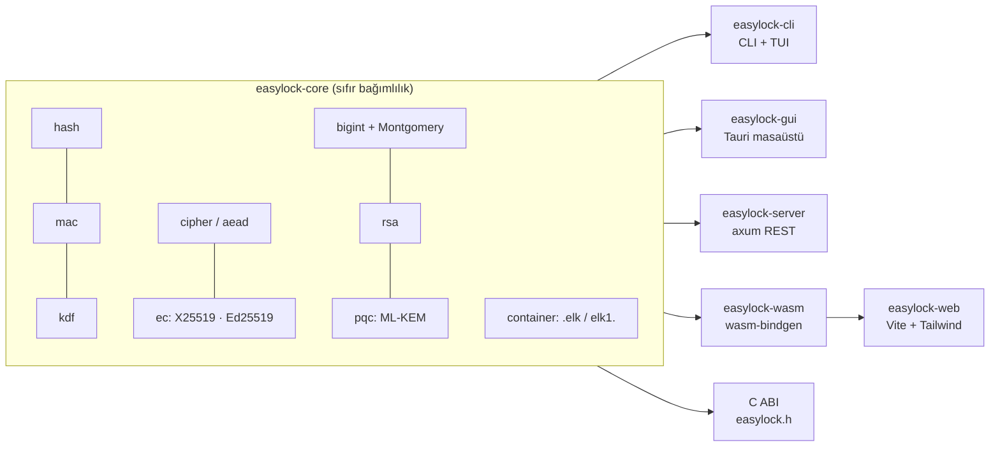

<div align="center">

<a href="https://zlixas.github.io/easylock/"></a>

<p>
  <a href="https://github.com/zlixas/easylock/releases/latest"></a>
  <a href="https://github.com/zlixas/easylock/actions/workflows/ci.yml"></a>
  <a href="https://zlixas.github.io/easylock/"></a>
  <a href="#lisans"></a>
  <a href="rust-toolchain.toml"></a>
  
  
</p>

<h3>
  <a href="https://zlixas.github.io/easylock/">🌐 Web uygulamasını aç</a>
  &nbsp;·&nbsp;
  <a href="#kurulum">⬇️ Kurulum</a>
  &nbsp;·&nbsp;
  <a href="docs/FILE_FORMAT.md">📄 Dosya biçimi</a>
  &nbsp;·&nbsp;
  <a href="docs/ARCHITECTURE.md">🧭 Mimari</a>
</h3>

[English](README.md) · Türkçe · [Español](README.es.md)

</div>

<br>

**easylock**, AES'ten kuantum sonrası ML-KEM'e kadar her yapı taşı temel ilkelerden ve **sıfır bağımlılıkla** **Rust ile
sıfırdan** yazılmış bir kriptografi araç setidir. Aynı motor **komut satırını**, **terminal arayüzünü**, **masaüstü
uygulamasını** ve **tamamen tarayıcınızda çalışan web sitesini** çalıştırır; dördü de aynı şifreli dosya biçimini paylaşır.

<table>
<tr>
<td width="33%" valign="top">

### 📦 Her şeyi şifreleyin
Dosyaları ve klasörlerin tamamını bir parolayla, başkalarının **açık anahtarlarıyla** ya da ikisiyle birden. Sabit bellekle saniyede birkaç GB hızında akış halinde çalışır.

</td>
<td width="33%" valign="top">

### 🛰️ Kuantum sonrası paylaşım
Alıcılar hibrit bir **X25519 + ML-KEM-768** anahtarı kullanır; bu sayede kaydedilmiş dosyalar gelecekteki bir kuantum bilgisayara karşı da güvende kalır.

</td>
<td width="33%" valign="top">

### 🔐 Şifreli kasalar
Dosyaların **şifreli kaldığı** bir klasör. Dosya adları ve boyutları da gizlenir; iCloud, Dropbox veya Git ile güvenle eşitlenir.

</td>
</tr>
<tr>
<td valign="top">

### 🎓 Yaparak öğrenin
Her birinde bir **Öğren** paneli (*ne · nasıl · ne zaman · dikkat edilecekler*) bulunan 20 etkileşimli araç; İngilizce, Türkçe ve İspanyolca.

</td>
<td valign="top">

### ⚡ Gerçekten hızlı
Elle yazılmış AES-NI / ARMv8, PCLMUL / PMULL, SHA-NI, NEON ve SSE2 yolları: **4,3 GB/s** AES-GCM, **2,4 GB/s** SHA-256.

</td>
<td valign="top">

### 🧪 Denetlenmek için yapıldı
Resmî NIST/RFC test vektörleri, **1.485 Wycheproof** uç durumu, fuzzing, karşılaştırmalı testler ve imzalı, kaynağı doğrulanabilir sürümler.

</td>
</tr>
</table>

<div align="center">
<a href="https://zlixas.github.io/easylock/"><picture><source media="(prefers-color-scheme: light)" srcset="docs/images/web-home-light.png"></picture></a>
<sub>Tarayıcınızda, açık ve koyu modda macOS tarzı bir uygulama. Ana sayfa, yazdıklarınızı WebAssembly'ye derlenmiş Rust motoruyla canlı olarak şifreler ve özetler.</sub>
</div>

> [!WARNING]
> **Eğitim amaçlıdır ve denetlenmemiştir.** Her yapı taşı temel ilkelerden yazılmış ve resmî test vektörleriyle
> (NIST CAVP, FIPS 197/180-4/202/203, RFC 7748/8032/8439/9106 …) ve Project Wycheproof ile doğrulanmıştır.
> Bu gereklidir ama kodu üretim ortamı için güvenli kılmaya **yetmez**. Kod henüz bağımsız olarak
> denetlenmedi. Gerçek sırları korumak için `age`, `ring`, RustCrypto, libsodium veya aws-lc gibi incelenmiş
> bir araç kullanın. Bkz. [SECURITY.md](SECURITY.md).

---

## İçindekiler

- [Neden easylock?](#neden-easylock)
- [Kurulum](#kurulum)
- [Hızlı başlangıç](#hızlı-başlangıç)
- [Neler var?](#neler-var)
- [Dört arayüz](#dört-arayüz)
- [Performans](#performans) · [Kalite ve güvence](#kalite-ve-güvence)
- [Mimari](#mimari) · [Derleme ve test](#derleme-ve-test)
- [Sık sorulanlar](#sık-sorulanlar) · [Yol haritası](#yol-haritası)
- [Katkıda bulunma](#katkıda-bulunma) · [Atıf](#atıf) · [Lisans](#lisans)

## Neden easylock?

Çoğu kişi kriptografiyi bir kara kutu olarak kullanır. easylock bu kutuyu açar:

- **Sıfırdan.** `easylock-core`'un çalışma zamanında *hiçbir* bağımlılığı yoktur. SHA-2, SHA-3, BLAKE3, AES ve
  GHASH'ini, ChaCha20-Poly1305'i, Argon2id'yi, Curve25519'u, sabit zamanlı bir büyük tamsayı motoruyla RSA'yı ve
  kuantum sonrası ML-KEM'i okunabilir Rust ile gerçekler.
- **Doğrulanmış.** 170'ten fazla test kodu yayımlanmış vektörlerle karşılaştırır ve kod `clippy::pedantic` altında hiçbir uyarı vermeden derlenir.
- **Açıklanmış.** Web sitesindeki her aracın dört bölümlü bir **Öğren** paneli vardır: *nedir*, *nasıl çalışır*,
  *ne zaman kullanılır* ve *nelere dikkat edilmeli*. Hepsi İngilizce, Türkçe ve İspanyolca olarak sunulur.
- **Birlikte çalışabilir.** Komut satırı, terminal arayüzü, masaüstü uygulaması ve web sitesi tek bir `.elk` dosya biçimini paylaşır.
  Terminalde kilitlediğiniz bir dosya web sitesinde, web sitesinde kilitlediğiniz bir dosya da terminalde açılır.
- **Gizli.** Web sitesi aynı Rust çekirdeğini WebAssembly'ye derler; bu yüzden bir sunucuya tek bir bayt bile göndermez.

## Kurulum

| Platform | Komut satırı + terminal arayüzü | Masaüstü uygulaması |
|---|---|---|
| **macOS** | `brew install zlixas/tap/easylock` | [Apple Silicon `.dmg`](https://github.com/zlixas/easylock/releases/latest/download/easylock-desktop-macos-arm64.dmg) · [Intel `.dmg`](https://github.com/zlixas/easylock/releases/latest/download/easylock-desktop-macos-x64.dmg) |
| **Linux** | `curl -fsSL https://raw.githubusercontent.com/zlixas/easylock/main/install.sh \| sh` | [`.AppImage`](https://github.com/zlixas/easylock/releases/latest/download/easylock-desktop-linux-x64.AppImage) · [`.deb`](https://github.com/zlixas/easylock/releases/latest/download/easylock-desktop-linux-x64.deb) |
| **Windows** | `irm https://raw.githubusercontent.com/zlixas/easylock/main/install.ps1 \| iex` | [Yükleyici `.exe`](https://github.com/zlixas/easylock/releases/latest/download/easylock-desktop-windows-x64.exe) · [`.msi`](https://github.com/zlixas/easylock/releases/latest/download/easylock-desktop-windows-x64.msi) |
| **Tarayıcı** | kurulum gerekmez: **<https://zlixas.github.io/easylock/>** (PWA olarak çevrimdışı da çalışır) | |
| **Kaynak kod** | `cargo install --git https://github.com/zlixas/easylock easylock-cli` | `cd crates/easylock-gui && cargo tauri build` |

Kurulum betikleri indirilen dosyayı sürümün `SHA256SUMS` dosyasıyla doğrular; Homebrew formülü de özetleri sabitler.
Her sürüm dosyası Ed25519 ile imzalanmış `SHA256SUMS` içinde listelenir ve GitHub derleme kaynağı (build provenance) kaydına sahiptir:

```sh
easylock verify --public "$(cat RELEASE_SIGNING_KEY.txt)" -S "$(cat SHA256SUMS.sig)" SHA256SUMS
gh attestation verify easylock-aarch64-apple-darwin.tar.gz --repo zlixas/easylock
```

> [!NOTE]
> Masaüstü uygulamaları henüz Apple veya Microsoft tarafından kod imzalı değildir. macOS'te ilk seferde sağ tıklayıp → **Aç**'ı,
> Windows'ta ise **Ek bilgi → Yine de çalıştır**'ı seçin.

## Hızlı başlangıç

```sh
easylock tui                               # tam ekran etkileşimli arayüz
easylock lock vergiler.pdf                 # → vergiler.pdf.elk  (parola sorar)
easylock unlock vergiler.pdf.elk           # → vergiler.pdf
easylock lock ~/Photos --shred             # tüm klasör → Photos.elk, orijinaller silinir

easylock identity                          # anahtar çiftiniz (X25519 + ML-KEM-768)
easylock lock rapor.pdf -r elkpub1…        # biri için şifreleyin, ortak parola gerekmez
easylock unlock rapor.pdf.elk              # kimliğinizle açılır
echo -n abc | easylock hash -a blake3
easylock password -n 3 -l 24 --symbols
easylock --lang tr --help                  # English · Türkçe · Español
```

## Neler var?

| Aile | Algoritmalar | Belirtim |
|---|---|---|
| Özet (hash) | SHA-256, SHA-512, SHA3-256/512, SHAKE128/256, Keccak-256, BLAKE2b, BLAKE3 | FIPS 180-4, FIPS 202, RFC 7693 |
| MAC | HMAC (her özetle), Poly1305 | RFC 2104, RFC 8439 |
| KDF / parolalar | Argon2id/i/d (PHC dizgeleri), PBKDF2, HKDF | RFC 9106, RFC 8018, RFC 5869 |
| AEAD | AES-256-GCM (AES-NI / ARMv8 ve PCLMUL / PMULL), ChaCha20-Poly1305 | SP 800-38D, RFC 8439 |
| Şifreler | AES-256, AES-256-CTR, ChaCha20 | FIPS 197 |
| Eliptik eğriler | X25519, Ed25519 | RFC 7748, RFC 8032 |
| RSA | anahtar üretimi, PKCS#1 v1.5, OAEP, CRT | RFC 8017 |
| Kuantum sonrası | ML-KEM-512 / 768 / 1024 (Kyber) | FIPS 203 |
| Kodlamalar | Hex, Base64, Base64URL, Base58, ROT13, zincirlenebilir işlem hatları | RFC 4648 |
| Kapsayıcılar | `.elk` dosyaları ve `elk1.` metin belirteçleri (Argon2id + parçalı AEAD) | [docs/FILE_FORMAT.md](docs/FILE_FORMAT.md) |

Yardımcı parçalar arasında `write_volatile` ile bellek temizleme, `Zeroizing<T>` / `Secret<N>`, sabit zamanlı karşılaştırma ve
seçim, çalışma zamanında CPU özelliğine göre yönlendirme, bir C ABI'si ([`easylock.h`](crates/easylock-core/include/easylock.h)) ve
`criterion` kıyaslamaları bulunur.

## Dört arayüz

### 🌐 Web sitesi (WebAssembly)

<table>
<tr>
<td width="50%"></td>
<td width="50%"></td>
</tr>
<tr>
<td align="center"><sub>Bir dosyayı parolayla, açık anahtarlarla ya da ikisiyle birden şifreleyin</sub></td>
<td align="center"><sub>Adım adım X25519 anahtar değişimi</sub></td>
</tr>
</table>

Web sitesinde beş kategoride 20 araç vardır. Her birinde bir *Öğren* paneli bulunur ve hepsi tamamen cihazınızda çalışır.

| | Araçlar |
|---|---|
| 🔒 Simetrik | Dosya şifrele (`.elk`, parola ve/veya açık anahtarlar) · Mesaj şifrele (`elk1.` belirteci) · AES-256-GCM · ChaCha20-Poly1305 |
| 🔑 Asimetrik | Dosya paylaşımı için anahtar çifti · Ed25519 imzala ve doğrula · Adım adım X25519 anahtar değişimi (Alice ⇄ Bob) · ML-KEM · RSA-2048 |
| ⚡ Özet ve KDF | Canlı çoklu özet · Sağlama doğrulayıcı (algoritmayı tanır) · HMAC · Argon2id ile özetleme ve doğrulama · PBKDF2 · HKDF |
| 🔄 Kodlama | Kodlama hattı · JWT inceleyici (HS256/HS512/EdDSA imzalarını doğrular) |
| 🛡️ Araçlar | Parola üretici · Parola gücü tahmini · Rastgele bayt / belirteç / UUID / PIN / parola cümlesi |

Sitede ayrıca bir komut paleti (<kbd>⌘/Ctrl</kbd>+<kbd>K</kbd> veya <kbd>/</kbd>), klavye kısayolları (<kbd>?</kbd>), telefonda da
çalışan bir düzen, EN/TR/ES dil seçici (<kbd>Alt</kbd>+<kbd>L</kbd>) ve son beş sonucu tutan kayan bir pano bulunur.
Pano, sekmeyi kapattığınızda veya 5 dakika işlem yapılmadığında temizlenir.
Site, **çevrimdışı** çalışan ve yüklenebilen bir **PWA**'dır. Üçüncü taraf isteklerine izin vermeyen sıkı bir Content-Security-Policy altında çalışır;
yavaş işlemler (Argon2, dosya şifreleme) bir Web Worker'da yürütüldüğü için sayfa hep tepki vermeye devam eder.

### 🗄️ Ayrıntılı dosya şifreleme

`easylock lock` gerçek dünyada kullanılmak üzere tasarlandı:

- **Akış halinde ve çok çekirdekli.** Bellek kullanımı dosya boyutundan bağımsız olarak sabittir (≈120 MB, çoğu Argon2 için). Parçalar bir
  işlem hattında tüm çekirdeklerde şifrelenir. 500 MB'lık bir dosya, son `fsync` öncesinde yaklaşık 0,3 saniye sürer.
- **Klasörler.** Klasör ağaçlarının tamamı tek bir `.elk` dosyasına girer. Dışarı çıkarma işlemi yol geçişi (path traversal) saldırılarına karşı korunur.
- **Açık anahtarlar.** `-r`, bir veya daha fazla kişi için X25519 + ML-KEM-768 hibritiyle şifreler; böylece dosyalar kuantum sonrası
  güvenlidir. `-r` ile `--with-password` birlikte kullanılabilir.
- **Varsayılan olarak güvenli.** Çıktı önce geçici bir dosyaya yazılır ve ancak işlem başarılı olup `fsync` edildikten sonra yeniden adlandırılır.
  Var olan dosyalar `--force` olmadan asla üzerine yazılmaz. Yanlış bir anahtar geride hiçbir şey bırakmaz.
- **`--shred`.** Başarılı bir şifrelemenin ardından orijinal dosyaların üzerine yazılır ve silinir.
- **Boru hatları.** Örnek: `tar c dir | easylock lock - -r KEY > backup.elk`.
- **Uyumlu.** Aynı dosyalar web sitesinde ve masaüstü uygulamasında da açılır; eski ELK1 dosyaları da hâlâ çözülebilir.

Bayt düzeyindeki biçim [docs/FILE_FORMAT.md](docs/FILE_FORMAT.md) dosyasında belgelenmiştir.

### 🔐 Şifreli kasa

Kasa, dosyaların **şifreli kaldığı** bir klasördür. Dosya adları, boyutları ve tarihleri şifreli bir dizinde gizlenir
ve kasaya hiçbir zaman açık metin yazılmaz.

```sh
easylock vault init ~/Private.vault                 # parola ve/veya -r açık anahtarlar
easylock vault add  ~/Private.vault taxes/ id.pdf --shred
easylock vault ls   ~/Private.vault
easylock vault cat  ~/Private.vault taxes/2025.pdf | open -f
easylock vault get  ~/Private.vault taxes -o ~/Desktop
easylock vault rm   ~/Private.vault id.pdf
easylock vault passwd ~/Private.vault -r elkpub1…   # hiçbir dosyayı yeniden şifrelemeden anahtarı değiştirir
```

Her dosya ayrı ve rastgele adlandırılmış bir nesne olduğu için kasalar Dropbox, iCloud veya Git üzerinden güvenle eşitlenir.

### ⌨️ Terminal arayüzü

```sh
easylock tui
```

Terminal arayüzü, klavyeyle kullanılan ve dokuz araç içeren bir ratatui uygulamasıdır: canlı özet, kodlama/çözme, parola üretimi,
anahtar çiftleri, parola tabanlı metin şifreleme, HMAC, Ed25519 imzalama/doğrulama, bir X25519 değişim gösterimi ve bir hakkında ekranı. Tuşlar:
<kbd>↑↓</kbd>/<kbd>1–9</kbd> araç seçer, <kbd>Tab</kbd> alanlar arasında gezinir, <kbd>F5</kbd> kopyalar,
<kbd>F2</kbd> dili değiştirir (EN → TR → ES) ve <kbd>F1</kbd> yardımı açar.

### 💻 Komut satırı

| Komut | Amaç |
|---|---|
| `hash` | stdin veya dosyalar üzerinde SHA-2/3, Keccak, BLAKE3 |
| `encode` / `decode` | zincirlenebilir Hex/Base64/Base58/ROT13 işlem hatları |
| `encrypt` / `decrypt` | ham anahtarla AEAD / CTR / XOR |
| `lock` / `unlock` | dosyaları **ve klasörleri** parolayla ve/veya açık anahtarlarla şifreler (`.elk`) |
| `inspect` | bir `.elk` dosyasının nasıl açılabileceğini gösterir, parola gerekmez |
| `identity` | açık anahtar kimliğinizi oluşturur veya gösterir |
| `vault` | şifreli kasa için `init` · `add` · `ls` · `get` · `cat` · `rm` · `passwd` · `info` |
| `hmac` | anahtarlı MAC'ler |
| `kdf` | Argon2id / PBKDF2; kayıtlı bir özeti denetlemek için `--verify <PHC>` |
| `password` | yansız rastgele parolalar ve entropileri |
| `keygen` | Ed25519, X25519, ML-KEM-512/768/1024, RSA-2048 (`--json`) |
| `sign` / `verify` | Ed25519 imzaları |
| `info` | sürüm, etkin donanım arka uçları, algoritma kataloğu |
| `tui` | terminal arayüzü |

Komut satırı her şeyi yerelleştirir: yardım metinleri, clap başlıkları, hatalar ve durum mesajları. Dili önce
`--lang en|tr|es` seçeneğinden, sonra `LC_ALL`/`LANG` değişkenlerinden alır; hiçbiri yoksa İngilizce kullanır.

```console
$ easylock --lang tr kdf -p hunter2
$argon2id$v=19$m=65536,t=3,p=4$…
$ easylock --lang es unlock secreto.elk -p mala
easylock: autenticación fallida: clave/nonce incorrectos o los datos fueron modificados
```

### 🖥️ Masaüstü uygulaması (Tauri v2)

```sh
cd crates/easylock-gui && cargo tauri build
```

Masaüstü uygulamasının dört sekmesi vardır: **Dosyalar** (akış halinde ilerleme gösteren, sürükle-bırak `.elk` şifreleme), **Özet**, **Dönüştür** ve
**Anahtarlar**. Uygulama `easylock-core`'u HTTP kullanmadan doğrudan Tauri IPC üzerinden çağırır ve EN, TR ve ES dillerinde kullanılabilir.

Ayrıca **`easylock-server`** da vardır: web panosunu da sunabilen bir `axum` REST API'si (`/v1/hash`, `/v1/aead/*`, `/v1/kdf/*`,
`/v1/keygen`, …).

## Performans

Bunlar bir Apple M4 üzerinde, `cargo bench -p easylock-core` ve `time` ile ölçülmüş tek süreçli sonuçlardır. Hepsi yine bağımlılıksız,
sıfırdan yazılmış koddur. Donanım yolları her işlemcinin kendi komutlarını kullanır, çalışma zamanında seçilir ve sabit zamanlı yazılıma geri döner.

| İşlem | Önce | Şimdi | Teknik |
|---|---:|---:|---|
| AES-256-GCM (256 KiB) | 1,0 GB/s | **4,3 GB/s** | 8 bloğu iç içe işleyen AES-NI / ARMv8 AES, toplu PCLMUL/PMULL GHASH (H¹…H⁸) |
| ChaCha20-Poly1305 (256 KiB) | 0,49 GB/s | **1,05 GB/s** | 4 bloklu NEON / SSE2 ChaCha20, 64 bit limb'li Poly1305 |
| SHA-256 (256 KiB) | 0,37 GB/s | **2,4 GB/s** | ARMv8 SHA2 / Intel SHA-NI komutları |
| Argon2id 64 MiB, t=3, p=4 | 121 ms | **32 ms** | şeritler birden çok çekirdekte doldurulur, blok kopyalanmaz |
| `lock` 500 MB dosya → /dev/null | 1,41 s, 1 GB RAM | **0,10–0,15 s, ~120 MB** | akış halinde, çok çekirdekli işlem hattı |
| `unlock` 500 MB dosya → /dev/null | 1,31 s | **0,18 s** | işlem hattıyla önden okuma, toplu bellek temizleme |

Her hızlı yol, karşılaştırmalı bir testte taşınabilir gerçeklemeyle karşılaştırılır: ARM'de yerel olarak, x86-64'te ise Rosetta altında ve CI'da.



## Kalite ve güvence

| Denetim | Yer |
|---|---|
| Resmî test vektörleri (NIST CAVP, RFC'ler, FIPS) | `cargo test` |
| **Project Wycheproof**: 1.485 uç durum vektörü | `crates/easylock-core/tests/wycheproof.rs` |
| Karşılaştırmalı testler: her SIMD/donanım yolu taşınabilir koda karşı | birim testleri; ARM, x86-64 ve taşınabilir derlemelerde |
| **Fuzzing** (cargo-fuzz): başlıklar, parça akışları, arşivler, çözücüler, AEAD | `fuzz/`, CI'da hedef başına 60 s |
| Bağımlılık denetimi: lisanslar, RustSec güvenlik duyuruları, kaynaklar | CI'da `cargo deny check` |
| Kapsam (coverage) | her CI çalışmasında `cargo llvm-cov` özeti |
| Sabitlenmiş CI eylemleri ve Dependabot | `.github/` |

Bir sorun mu buldunuz? Bkz. [SECURITY.md](SECURITY.md).

## Mimari



Kaynak kodda rehberli bir gezinti için **[docs/ARCHITECTURE.md](docs/ARCHITECTURE.md)** belgesine bakın. Belge sabit zamanlı teknikleri,
CPU yönlendirmesini, büyük tamsayı motorunun nasıl çalıştığını ve okumaya nereden başlanacağını anlatır.

| Paket (crate) | Görevi |
|---|---|
| [`easylock-core`](crates/easylock-core) | Tüm yapı taşları, sabit zamanlı `BigUint<N>`, kapsayıcılar, FFI |
| [`easylock-cli`](crates/easylock-cli) | `easylock` programı: komut satırı + ratatui terminal arayüzü, EN/TR/ES |
| [`easylock-gui`](crates/easylock-gui) | Tauri v2 masaüstü uygulaması |
| [`easylock-server`](crates/easylock-server) | REST API + statik barındırma |
| [`easylock-wasm`](crates/easylock-wasm) | WebAssembly bağlamaları |
| [`easylock-web`](crates/easylock-web) | Tarayıcı ön yüzü (çatısız, saf JS) |

## Derleme ve test

```sh
cargo test   --workspace                  # vektörlere dayanan 170'ten fazla test
cargo clippy --workspace --all-targets    # clippy::pedantic altında uyarısız
cargo bench  -p easylock-core             # criterion kıyaslamaları

# web sitesi
cd crates/easylock-web
npm install
npm run wasm     # easylock-wasm'ın wasm-pack derlemesi
npm run dev      # http://localhost:5173
```

Sürüm derlemeleri `x86_64`/`aarch64` Linux, Apple Silicon ve Intel macOS ile `x86_64` Windows'u kapsar. CI; Ubuntu, macOS ve Windows'ta fmt, clippy (pedantic) ve test takımını, ayrıca WebAssembly, cargo-deny, fuzzing ve kapsam işlerini çalıştırır.

## Belgeler

| Belge | |
|---|---|
| [docs/ARCHITECTURE.md](docs/ARCHITECTURE.md) | Tasarım, modül haritası, sabit zamanlı teknikler |
| [docs/FILE_FORMAT.md](docs/FILE_FORMAT.md) | `.elk` dosyalarının ve `elk1.` belirteçlerinin bayt düzeyinde belirtimi |
| [SECURITY.md](SECURITY.md) | Tehdit modeli, bilinen sınırlamalar, sorunların nasıl bildirileceği |
| [CONTRIBUTING.md](CONTRIBUTING.md) | Geliştirme ortamı, kodlama standartları, yeni bir yapı taşı veya dil ekleme |
| [CHANGELOG.md](CHANGELOG.md) | Sürüm geçmişi |

## Sık sorulanlar

<details>
<summary><b>Web sitesini kullandığımda dosyalarım bir yere yükleniyor mu?</b></summary>

Hayır. Rust motoru tarayıcınızın içinde WebAssembly olarak çalışır. Content-Security-Policy yalnızca sitenin kendi dosyalarına izin verir,
hiçbir üçüncü taraf kodu yüklenmez ve site bir kez ziyaret edildikten sonra uçak modunda da çalışır.
</details>

<details>
<summary><b>Web sitesinde kilitlenen bir dosya terminalde açılabilir mi (ya da tersi)?</b></summary>

Evet. Web sitesi, komut satırı, terminal arayüzü ve masaüstü uygulaması aynı `.elk` biçimini bayt bayt aynı şekilde okur ve yazar.
</details>

<details>
<summary><b>Açık anahtarlı dosyalar için "kuantum sonrası" ne anlama geliyor?</b></summary>

Her alıcı yuvası X25519'u ML-KEM-768 (FIPS 203) ile birleştirir ve sarmalama anahtarını her iki ortak sırdan türetir.
Saldırganın ikisini birden kırması gerekir; bu yüzden yalnızca X25519'u kırabilen gelecekteki bir kuantum bilgisayar dosyayı açamaz.
</details>

<details>
<summary><b>Bunun age veya GPG'den farkı ne?</b></summary>

`age` ve GPG olgun, incelenmiş araçlardır; gerçek sırlar için onları tercih etmelisiniz. easylock ise **okunmak ve
öğrenmek** için var: alttaki her yapı taşı bu depoda; okunabilir, test edilmiş ve açıklanmış durumda. Üstelik
hepsi bir tarayıcıda da çalışır.
</details>

<details>
<summary><b>Parolamı unutursam ne olur?</b></summary>

Dosya kurtarılamaz; amaç da budur. Önemli dosyalar için ikinci bir açma yolu olarak açık anahtarınızı ekleyin:
`easylock lock file -r "$(easylock identity --show)" --with-password`.
</details>

## Yol haritası

- [x] Parola ve hibrit kuantum sonrası alıcılarla akış halinde, çok çekirdekli `.elk` v2
- [x] Şifreli kasalar · Linux, macOS ve Windows için imzalı, kaynağı doğrulanabilir sürümler · Homebrew
- [x] Sıkı CSP ve Web Worker'da kriptografi ile çevrimdışı PWA
- [x] Daha hızlı Curve25519 (2^51 tabanlı alan aritmetiği, önceden hesaplanmış taban tablosu: X25519 ve Ed25519'da ~40 kat hız)
- [ ] Terminal arayüzünde ve masaüstü uygulamasında kasa tarayıcısı
- [ ] BLAKE3 SIMD
- [ ] Kod imzalı masaüstü derlemeleri
- [ ] Bağımsız bir güvenlik denetimi

Fikirlere ve pull request'lere açığız, bkz. [Katkıda bulunma](#katkıda-bulunma).

## Katkıda bulunma

Katkılarınızı bekliyoruz: yeni yapı taşları, daha fazla test vektörü, çeviriler, belgeler ve hata bildirimleri.
Lütfen [CONTRIBUTING.md](CONTRIBUTING.md) dosyasını ve [Davranış Kuralları](CODE_OF_CONDUCT.md)'nı okuyun.

## Atıf

easylock öğretiminize veya araştırmanıza yardımcı oluyorsa [CITATION.cff](CITATION.cff) dosyasıyla atıfta bulunabilirsiniz. GitHub'ın
"Cite this repository" düğmesi bu dosyayı kullanır.

## Lisans

easylock, tercihinize göre aşağıdakilerden biriyle çift lisanslıdır:

- Apache License, Version 2.0 ([LICENSE-APACHE](LICENSE-APACHE))
- MIT lisansı ([LICENSE-MIT](LICENSE-MIT))

<div align="center">
<br>
<sub>🦀 ve bolca test vektörüyle yapıldı · <a href="https://zlixas.github.io/easylock/">zlixas.github.io/easylock</a></sub>
</div>
